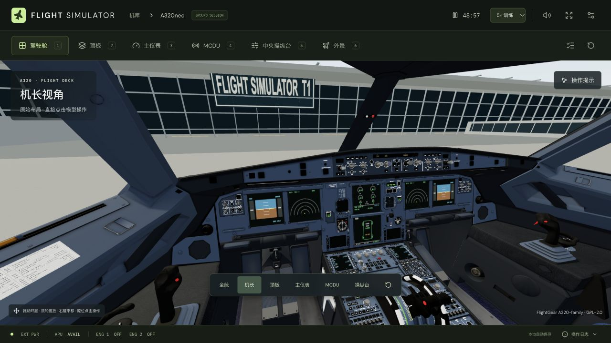
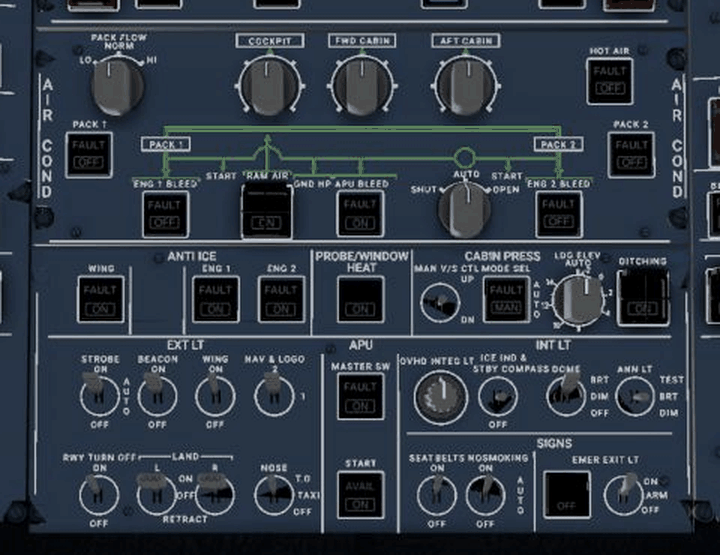
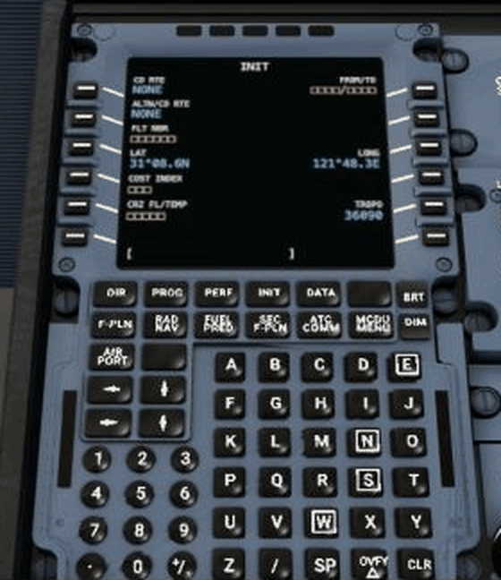
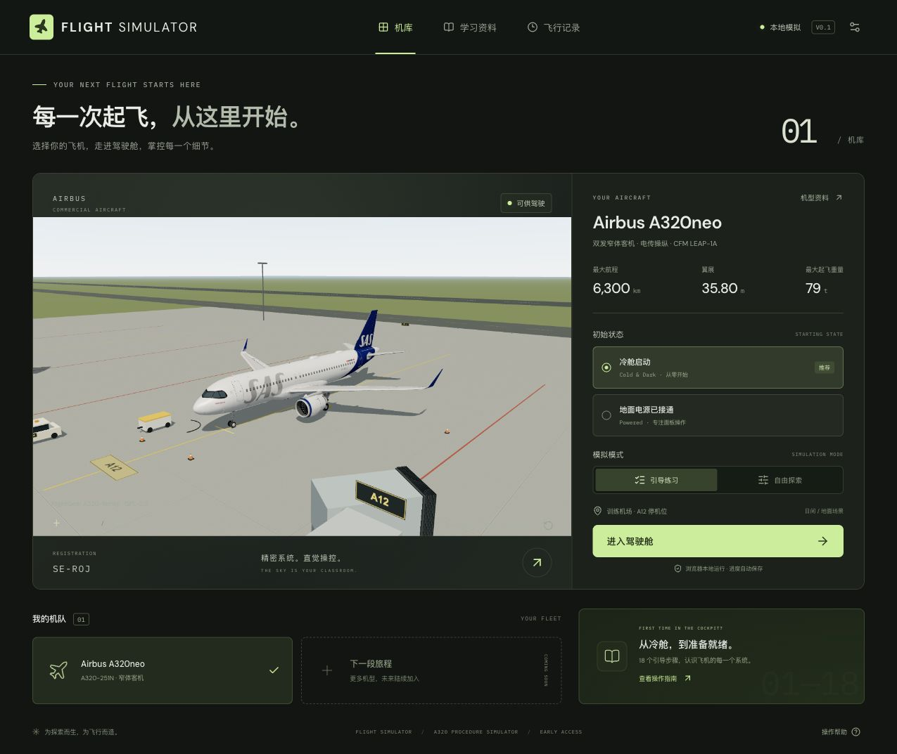
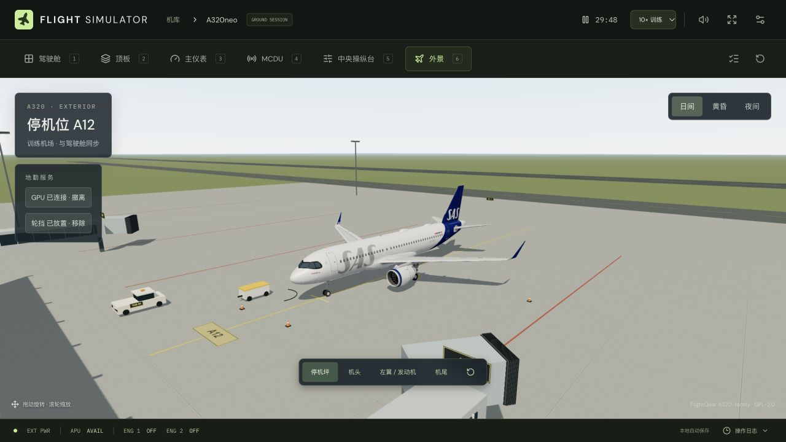
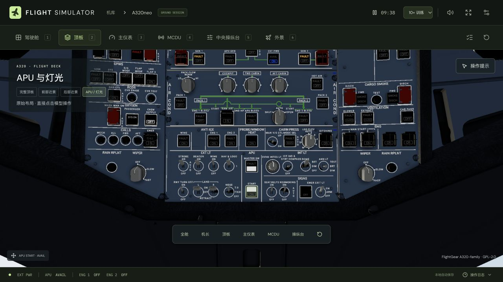
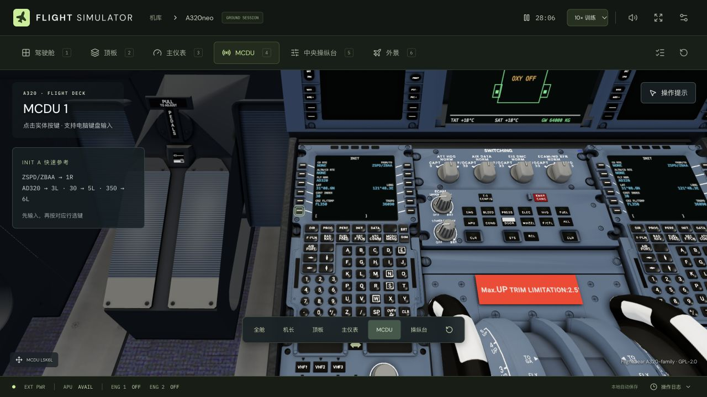

<a id="top"></a>

<div align="center">

<p><a href="README.md">English</a> · <strong>简体中文</strong></p>


<h1>FLIGHT SIMULATOR</h1>

<p><strong>在浏览器里，走进 A320 驾驶舱。</strong></p>
<p>探索完整机模，操作原位面板，观察飞机系统的每一次响应。</p>

<p>
  <a href="package.json"></a>
  <a href="#development"></a>
  <a href="#development"></a>
  <a href="#development"></a>
  <a href="#development"></a>
  <a href="THIRD_PARTY_NOTICES.md"></a>
</p>

<p>
  <a href="#overview">简介</a> ·
  <a href="#showcase">预览</a> ·
  <a href="#quick-start">开始</a> ·
  <a href="#controls">操作</a> ·
  <a href="#deployment">部署</a> ·
  <a href="#development">开发</a>
</p>

</div>

<p align="center">
  
  <br />
  <sub>项目实际运行画面 · 驾驶舱原始布局 · 直接点击模型操作</sub>
</p>

<table align="center">
  <tr>
    <td align="center" width="33%"><strong>A320neo</strong><br /><sub>完整驾驶舱与机身</sub></td>
    <td align="center" width="33%"><strong>18 步引导</strong><br /><sub>从冷舱上电到双发启动</sub></td>
    <td align="center" width="33%"><strong>每台 MCDU 72 键</strong><br /><sub>双侧设备，保留原位布局</sub></td>
  </tr>
</table>

<a id="overview"></a>

## 项目介绍

**FLIGHT SIMULATOR** 是一个面向飞行模拟爱好者的 Web 3D 驾驶舱交互项目，使用 React、TypeScript 与 Three.js 构建。目前以 **Airbus A320neo** 为核心机型，可以自由探索驾驶舱，直接在模型原位置操作已接入的开关、旋钮与按键；机械动作、指示灯、仪表读数和声音由同一套飞机状态驱动。

你可以跟随检查单，从冷舱上电、APU 启动、MCDU 初始化一路完成发动机启动，也可以进入自由探索模式，观察系统之间的依赖与反馈。驾驶舱基于 FlightGear A320-family 精细模型，保留面板的原始位置。应用以静态网站运行，模拟进度保存在浏览器中。

| 体验 | 已实现的内容 |
| --- | --- |
| **完整机模** | 完整驾驶舱与机身；机长、顶板、主仪表、MCDU、中央操纵台和外景视角；支持环顾、缩放与平移。 |
| **原位交互** | 已接入的开关与按钮支持机械动作、文字标识、指示灯和仪表显示联动。 |
| **冷舱引导** | 18 步引导覆盖电源、火警测试、氧气与标志灯、惯导、燃油、APU、引气、MCDU 和发动机启动。 |
| **系统联动** | 电源交接、APU 启动与冷却、发动机分阶段启动、N2 / EGT / 燃油流量、PACK、液压、襟翼、ECAM 及部分 FCU 操作。 |
| **音效反馈** | 18 种本地 WAV 采样，包括开关、继电器、通风、APU、发动机、襟翼、PTU 与告警；支持舱内外混音。 |
| **机场环境** | 训练机场、航站楼、廊桥、地勤设备、滑行道和跑道；支持日间、黄昏与夜间。 |
| **练习记录** | 引导 / 自由模式、1× / 5× / 10× 时间倍率、暂停、浏览器自动保存与 JSON 操作日志导出。 |

> [!NOTE]
> 当前重点是**地面准备流程与驾驶舱交互**，尚未实现完整飞行动力学、推出 / 滑行、全球地景、导航数据库、完整 FMGS / 自动驾驶和全部故障逻辑。系统行为经过简化，适合兴趣探索与流程学习，不用于真实航空操作或认证训练。

<a id="showcase"></a>

## 界面展示

以下动图均录自项目实际运行界面。GIF 不含声音；APU 演示使用加速的模拟时间。

<table align="center">
  <tr>
    <th width="58%">APU 启动与指示灯</th>
    <th width="42%">MCDU 原位输入</th>
  </tr>
  <tr>
    <td align="center" valign="top"></td>
    <td align="center" valign="top"></td>
  </tr>
  <tr>
    <td>点击顶板原位置按钮，观察系统状态与指示灯变化。</td>
    <td>点击模型键盘，再通过行选键写入输入内容。</td>
  </tr>
</table>

### 走近机模

从停机坪、机头、发动机与机尾视角，查看完整机身和机场环境。

<p align="center">
  
</p>

<details>
<summary><strong>更多截图：机库、外景、顶板与 MCDU 细节</strong></summary>

| 机库与模拟设置 | 机模与机场外景 |
| --- | --- |
|  |  |

| 顶板原位按钮 | MCDU 操作细节 |
| --- | --- |
|  |  |

</details>

<a id="quick-start"></a>

## 快速开始

**环境要求：** Node.js `^20.19.0 || >=22.12.0`、npm，以及支持 WebGL 的浏览器。

```bash
git clone https://github.com/radebit/flight-simulator.git
cd flight-simulator
npm ci
npm run dev
```

打开 **<http://127.0.0.1:5173/>**。

首次体验建议选择 **「冷舱启动」+「引导练习」**，跟随检查单逐项操作，点击步骤即可定位相关面板。若想直接探索已上电的驾驶舱，可以选择 **「地面电源已接通」+「自由探索」**。当前应用界面为简体中文，飞机面板保留英文标识。

模型和音频随项目提供，无需外部模型 API。外部机模约 10 MB、驾驶舱约 51 MB，首次加载请等待资源下载完成。

<a id="controls"></a>

## 操作指南

| 操作 | 方式 |
| --- | --- |
| 切换面板 | 顶部导航，或数字键 `1`–`6` |
| 移动视角 | 鼠标拖动环顾，滚轮缩放，右键拖动平移 |
| 操作开关与按钮 | 直接点击模型原位置；开启「操作提示」可查看支持的控件 |
| 调整旋钮 | 支持的控件可用滚轮 / 方向键；`Shift` + 点击反向调整 |
| 火警 / 灯光测试 | 按住 TEST，松开结束 |
| MCDU 输入 | 点击物理键盘；聚焦后也可用电脑键盘输入 |
| MCDU 删除 | `CLR` 删除字符，`Delete` 清空暂存行 |
| 暂停 / 恢复 | 顶部计时按钮，或未聚焦输入控件时按空格 |
| 音效 | 首次交互后启用；顶部可静音，设置中可调音量 |

<details>
<summary><strong>动手试试：MCDU INIT A 输入示例</strong></summary>

先将内容输入暂存行，再按对应的行选键写入字段。

| 输入 | 行选键 | 字段 |
| --- | --- | --- |
| `ZSPD/ZBAA` | `1R` | 起飞机场 / 到达机场 |
| `AD320` | `3L` | 航班号 |
| `30` | `5L` | 成本指数 |
| `350` | `6L` | 巡航高度 |

</details>

<a id="deployment"></a>

## 部署说明

构建后是静态网站，可部署到 OpenResty、Nginx 或其他静态文件服务器，无需在生产环境运行 Node.js。

**根目录部署 · 默认**

```bash
npm run build
```

将 **`dist/` 内的全部内容**直接上传到站点根目录。

**子目录部署 · 可选**

```bash
npm run build -- --base=/flight-simulator/
```

将示例替换为需要的子目录，并把 `dist/` 内的全部内容上传到对应目录。参数只影响本次构建，项目默认仍为 `/`。路径以 `/` 开头和结尾；请将 `assets/`、`models/`、`audio/`、`favicon.svg` 与 `index.html` 一起上传。

详细配置与排查步骤见 [部署文档](docs/DEPLOYMENT.md) 和 [OpenResty 配置片段](docs/openresty.conf)。

<a id="development"></a>

## 开发指南

| 用途 | 技术 |
| --- | --- |
| 界面与类型 | React 19 · TypeScript 7 |
| 3D 渲染 | Three.js · React Three Fiber · Drei |
| 系统与音效 | 独立状态逻辑 · Web Audio API |
| 构建与测试 | Vite 8 · Vitest |

依赖的精确版本以 [`package-lock.json`](package-lock.json) 为准。

```bash
npm test          # 运行测试
npm run build     # TypeScript 检查与生产构建，输出 dist/
npm run preview   # 本地预览生产构建
```

<details>
<summary><strong>项目目录</strong></summary>

```text
src/
  App.tsx                 # 机库、模拟会话与检查单
  assetUrl.ts             # 跟随构建基础路径解析公共资源
  sim/                    # 飞机系统、流程与 MCDU 逻辑
  scene/                  # 驾驶舱、机模、控件与机场
  audio/                  # 音效加载与混音
public/
  models/a320/            # GLB、清单、许可与模型源码包
  audio/a320/             # WAV 与来源清单
vendor/flightgear-a320/   # 固定版本的上游几何、贴图与声音
scripts/                 # 模型转换与源码打包
tests/                   # 系统、音频与模型回归测试
docs/                    # 截图、动图与部署文档
```

</details>

## 素材与致谢

机模、贴图和声音采样来自 **[FlightGear A320-family](https://github.com/legoboyvdlp/A320-family)**，按 **GPL-2.0** 分发。仓库保留了原始素材、许可文本与修改说明。

详见 [第三方声明](THIRD_PARTY_NOTICES.md)、[素材修改说明](public/models/a320/NOTICE.txt) 与 [素材许可证](public/models/a320/LICENSE.txt)。顶部素材许可徽章描述的是这些随附资源。本项目与 Airbus、FlightGear 或 Scandinavian Airlines 不存在隶属或背书关系。

---

<p align="center">
  <a href="#top">返回顶部</a> · <a href="README.md">English</a> · <a href="https://github.com/radebit/flight-simulator/issues">反馈问题</a>
</p>
